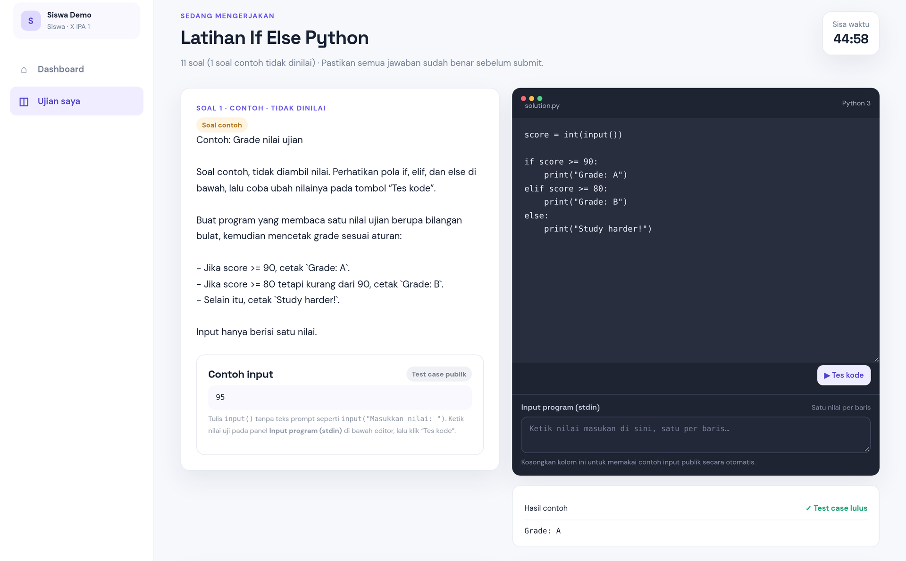
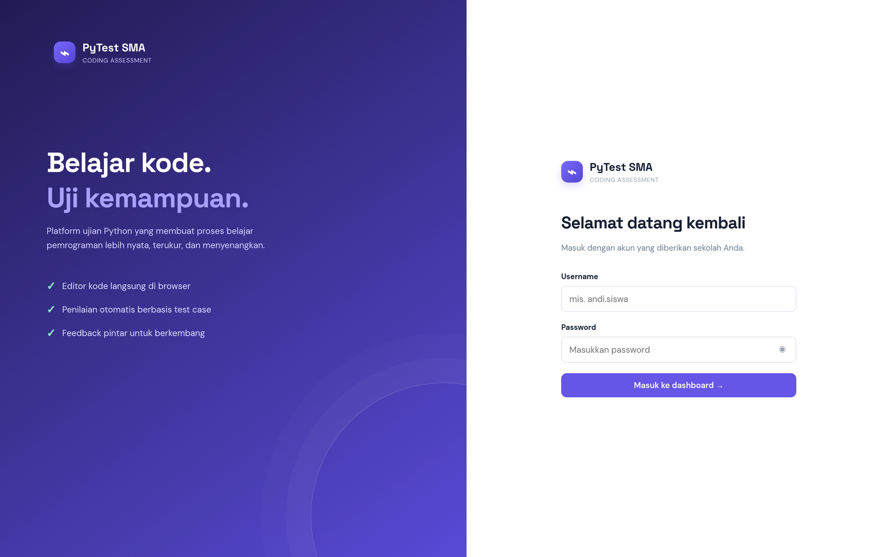
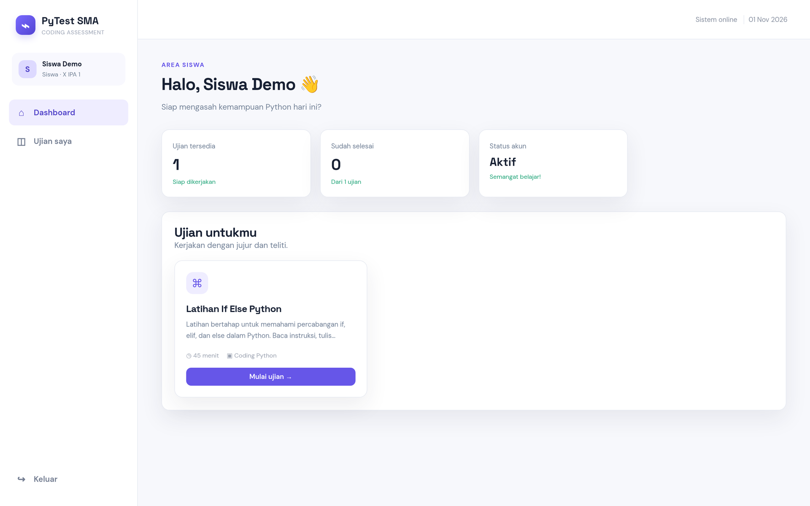
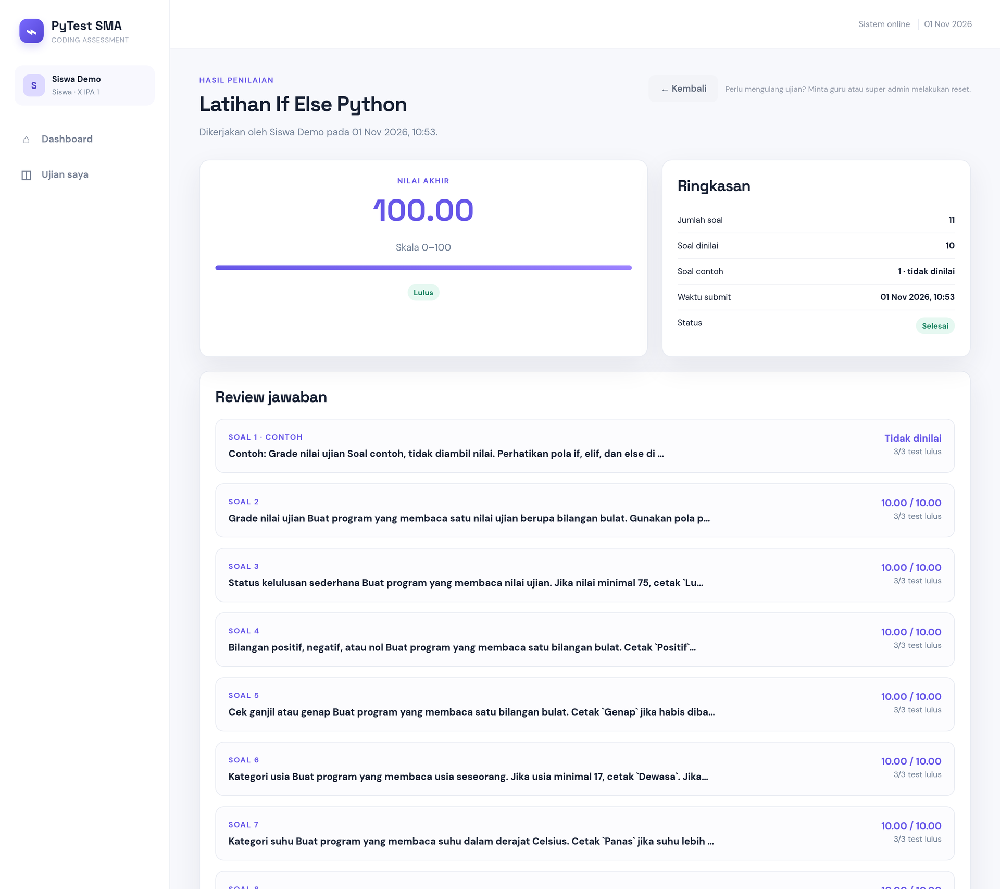
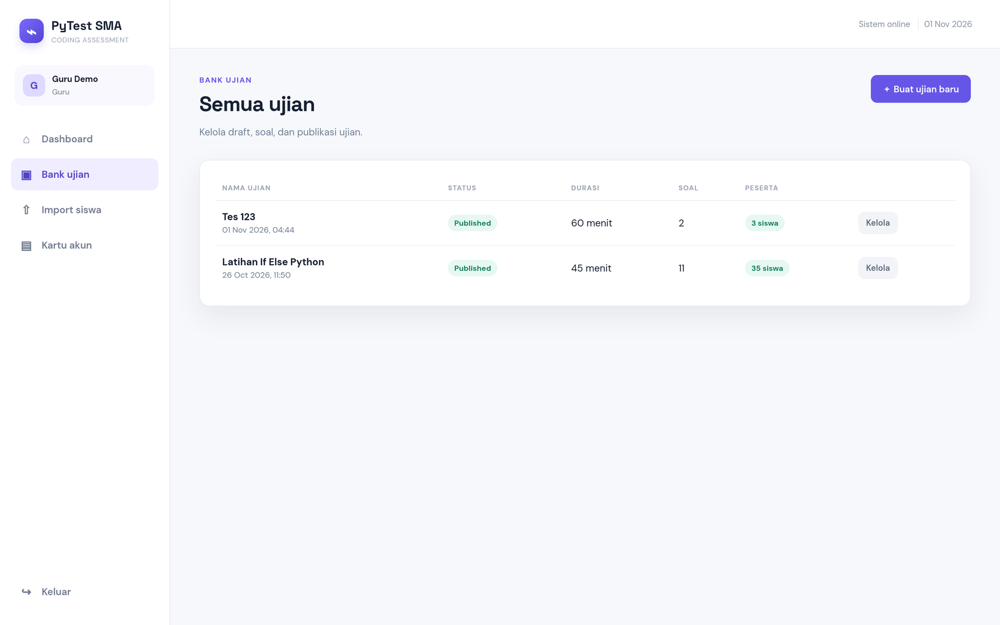
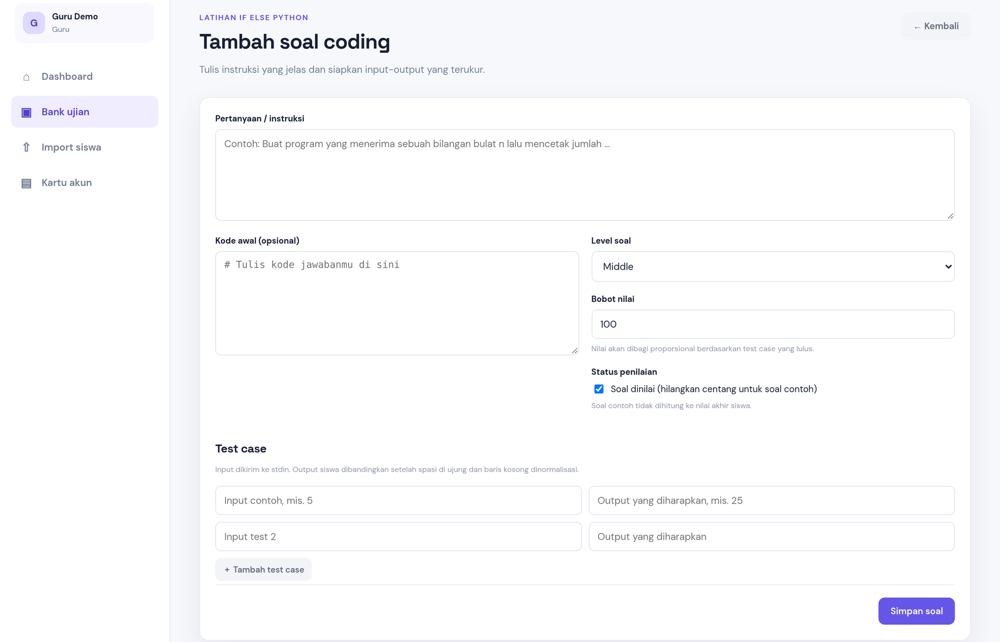

<div align="center">

# ⌁ PyTest SMA

**Platform ujian coding Python untuk SMA** — siswa menulis kode langsung di browser, sistem menjalankan dan menilainya otomatis dari test case, guru memantau semuanya dari satu dashboard ringan.

[](https://tes.kka-sma.biz.id)
[](https://www.php.net/)
[](https://mariadb.org/)
[](https://www.python.org/)
[](LICENSE)

</div>



> **Ujian yang sebenarnya, bukan kuis pilihan ganda.** Setiap jawaban dijalankan
> dengan Python 3 memakai input dari database, lalu outputnya dibandingkan
> dengan jawaban yang diharapkan — persis seperti autocorrect di kompetisi
> pemrograman, tetapi sesederhana aplikasi web sekolah.

---

## ✨ Kenapa PyTest SMA?

| | |
| --- | --- |
| 🧑‍💻 **Editor kode di browser** | Siswa menulis solusi Python tanpa install apa pun, lengkap dengan tombol **▶ Tes kode** dan panel **Input program (stdin)** seperti terminal interaktif. |
| ⚖️ **Penilaian otomatis & adil** | Setiap soal punya beberapa test case berbobot; nilai dihitung proporsional dari test yang lulus, dengan normalisasi spasi/baris kosong. |
| 🧪 **Soal contoh tidak dinilai** | Soal latihan bisa ditandai *contoh* agar siswa paham pola `if/elif/else` sebelum mengerjakan soal yang dinilai. |
| 🎯 **Peserta ujian terbatas** | Batasi ujian untuk kelas tertentu, siswa tertentu, atau hasil import `.csv`/`.xlsx`. |
| ♻️ **Reset & ulang ujian** | Super admin dapat menghapus pengerjaan satu siswa (atau semua siswa pada satu ujian) agar bisa mengerjakan ulang dari awal. |
| 📇 **Kartu akun & kunci jawaban** | Cetak kartu username/password per kelas (PDF A4 siap gunting) dan dokumen kunci jawaban berwarna. |
| 🤖 **Feedback AI opsional** | Umpan balik singkat berbahasa Indonesia dari model OpenAI-compatible — bisa dimatikan cukup dengan mengosongkan API key. |
| 📱 **Responsif** | Nyaman dipakai di laptop lab komputer maupun tablet. |

---

## 📸 Cuplikan layar

<table>
<tr>
<td align="center" width="50%">

**Login — satu pintu untuk siswa, guru, dan super admin**



</td>
<td align="center" width="50%">

**Dashboard siswa — ujian yang tersedia & progres**



</td>
</tr>
<tr>
<td align="center" width="50%">

**Halaman ujian — soal, editor kode, stdin, hasil tes**


</td>
<td align="center" width="50%">

**Hasil penilaian — nilai akhir & review per soal**



</td>
</tr>
<tr>
<td align="center" width="50%">

**Bank ujian — kelola draft, soal, dan publikasi**



</td>
<td align="center" width="50%">

**Tambah soal — instruksi, kode awal, bobot, test case**



</td>
</tr>
</table>

<p align="center"><em>Screenshot diambil dari aplikasi berjalan; nama guru/siswa
pada gambar adalah akun demo.</em></p>


---

## 🔁 Alur singkat

```text
Guru / Super admin            Siswa                         Sistem
──────────────────           ─────────────────────         ─────────────────────────
Buat ujian + soal      ──▶   Login, buka ujian       ──▶   Buat attempt & timer
Tentukan test case           Tulis kode Python             Jalankan kode (Python 3)
Pilih peserta/kelas    ──▶   ▶ Tes kode (opsional)   ──▶   Bandingkan output
Publikasikan ujian           Submit jawaban          ──▶   Nilai + feedback AI (opsional)
Lihat hasil / reset    ◀──   Lihat nilai & review
```

1. **Guru** membuat ujian, menulis instruksi soal, kode awal, bobot, dan test case (input → output yang diharapkan).
2. **Siswa** mengerjakan di editor, mencoba dengan panel stdin, lalu submit sebelum waktu habis.
3. **Sistem** menjalankan setiap jawaban dan menilai secara proporsional; soal contoh tetap ditampilkan tetapi tidak dihitung.
4. **Guru/super admin** melihat hasil, dan bila perlu melakukan **reset** agar siswa dapat mengulang.

---

## 🧰 Teknologi

- **PHP 8.4 native** — tanpa framework dan tanpa Composer, mudah di-deploy di VPS kecil.
- **MariaDB / MySQL** — skema sederhana (`users`, `exams`, `questions`, `test_cases`, `attempts`, `answers`, `exam_participants`).
- **Python 3 CLI** — mengeksekusi kode siswa dalam proses terpisah, mode isolated, dengan batas waktu & ukuran input.
- **nginx + PHP-FPM** — konfigurasi contoh disertakan di bawah (Apache juga bisa lewat `.htaccess`).
- **HTML/CSS/JS ringan** — tanpa build step; aset statis di `public/assets`.

---

## 🗂️ Struktur proyek

```text
tes-online-pyhton/
├── app/
│   ├── Auth.php            # sesi, role, CSRF
│   ├── Database.php        # koneksi PDO
│   ├── bootstrap.php       # inisialisasi aplikasi
│   └── functions.php       # util, penilaian, eksekusi Python, AI feedback
├── config/config.php       # pembacaan .env + default aman (tanpa rahasia)
├── database/
│   ├── schema.sql          # skema awal
│   ├── migrations/         # migrasi bertahap
│   └── build-students-template.php  # generator template import
├── docs/
│   ├── manual-guru-pembuatan-soal.html
│   ├── manual-guru-pembuatan-soal.pdf
│   └── screenshots/        # gambar untuk README
├── public/                 # document root (index.php, assets, template)
├── storage/                # exports & uploads (tidak ikut di-commit)
├── views/partials/         # header/footer tampilan
├── .env.example
└── index.php               # penerus ke public/index.php untuk hosting tanpa docroot
```


---

## 🚀 Instalasi di VPS

Contoh di bawah mengikuti server produksi: **Debian 13 + nginx + PHP 8.4 FPM +
MariaDB**. Jalankan sebagai user yang punya `sudo`.

<details open>
<summary><b>1. Pasang paket</b></summary>

```bash
sudo apt update
sudo apt install -y nginx mariadb-server rsync python3 \
  php8.4-fpm php8.4-cli php8.4-mysql php8.4-curl php8.4-mbstring php8.4-xml php8.4-zip
sudo systemctl enable --now nginx php8.4-fpm mariadb
```

Pada Debian 13 paket `php8.4-*` tersedia di repositori utama; di Ubuntu tambahkan
PPA `ondrej/php` lebih dulu.

</details>

<details open>
<summary><b>2. Salin kode aplikasi</b></summary>

```bash
sudo mkdir -p /var/www/tes-online-python
sudo rsync -a --delete ./ /var/www/tes-online-python/
sudo chown -R www-data:www-data /var/www/tes-online-python
sudo find /var/www/tes-online-python -type d -exec chmod 755 {} +
sudo find /var/www/tes-online-python -type f -exec chmod 644 {} +
sudo chmod -R g+w /var/www/tes-online-python/storage
```

Document root diarahkan ke subfolder `public/`, bukan akar proyek, supaya
`app/`, `storage/`, dan `.env` tidak bisa diakses lewat browser.

</details>

<details open>
<summary><b>3. Siapkan database</b></summary>

```bash
sudo mysql -e "CREATE DATABASE ujian_python CHARACTER SET utf8mb4 COLLATE utf8mb4_unicode_ci;"
sudo mysql -e "CREATE USER 'pytest'@'127.0.0.1' IDENTIFIED BY 'password_kuat';"
sudo mysql -e "GRANT ALL PRIVILEGES ON ujian_python.* TO 'pytest'@'127.0.0.1'; FLUSH PRIVILEGES;"
sudo mysql ujian_python < /var/www/tes-online-python/database/schema.sql
```

Untuk instalasi lama, jalankan migrasi sesuai urutan:

```bash
cd /var/www/tes-online-python
sudo mysql ujian_python < database/migrations/2026-10-27-question-selection.sql
sudo mysql ujian_python < database/migrations/2026-10-28-if-else-questions.sql
sudo mysql ujian_python < database/migrations/2026-10-29-example-questions.sql
sudo mysql ujian_python < database/migrations/2026-11-01-exam-participants.sql
```

</details>

<details open>
<summary><b>4. Buat file <code>.env</code></b></summary>

Salin dari `.env.example` lalu isi nilainya. File ini **tidak** disertakan di
repositori dan tidak boleh dibagikan.

```bash
sudo -u www-data cp /var/www/tes-online-python/.env.example /var/www/tes-online-python/.env
sudo -u www-data nano /var/www/tes-online-python/.env
sudo chown www-data:www-data /var/www/tes-online-python/.env
sudo chmod 640 /var/www/tes-online-python/.env
```

Jangan memakai user `root` sebagai user database produksi.

</details>

<details>
<summary><b>5. Konfigurasi nginx + PHP-FPM</b></summary>

Buat `/etc/nginx/sites-available/tes-online-python.conf`:

```nginx
server {
    listen 80;
    server_name domain-anda.sch.id;

    root /var/www/tes-online-python/public;
    index index.php index.html;

    access_log /var/log/nginx/tes-online-python.access.log;
    error_log  /var/log/nginx/tes-online-python.error.log;

    client_max_body_size 20M;

    location / {
        try_files $uri $uri/ /index.php?$query_string;
    }

    location ~ \.php$ {
        include snippets/fastcgi-php.conf;
        fastcgi_pass unix:/run/php/php8.4-fpm.sock;
        fastcgi_read_timeout 120s;
    }

    location ~ /\.(?!well-known) {
        deny all;
    }

    location ~* \.(css|js|png|jpg|jpeg|gif|ico|svg|woff|woff2|ttf)$ {
        expires 7d;
        access_log off;
        try_files $uri =404;
    }
}
```

```bash
sudo ln -s /etc/nginx/sites-available/tes-online-python.conf /etc/nginx/sites-enabled/
sudo nginx -t && sudo systemctl reload nginx
```

`fastcgi_read_timeout 120s` memberi ruang untuk penilaian banyak test case,
sedangkan batas waktu tiap program tetap diatur aplikasi.

</details>

<details>
<summary><b>6. HTTPS (Let's Encrypt)</b></summary>

```bash
sudo apt install -y certbot python3-certbot-nginx
sudo certbot --nginx -d domain-anda.sch.id
sudo certbot renew --dry-run
```

Jika VPS memakai firewall, izinkan HTTP/HTTPS lebih dulu
(`sudo ufw allow 'Nginx Full'`).

</details>

<details>
<summary><b>7. Pemeriksaan akhir</b></summary>

```bash
php -v
php -m | grep -E 'pdo_mysql|curl|mbstring|xml|zip'   # semua harus muncul
sudo -u www-data python3 --version                   # harus bisa dijalankan user web
sudo systemctl status nginx php8.4-fpm mariadb --no-pager
```

- `PYTHON_BIN` harus menunjuk biner Python yang bisa dijalankan `www-data`.
  Tanpa Python CLI, tombol **Tes kode** dan penilaian otomatis tidak berfungsi.
- `storage/exports` dan `storage/uploads` harus dapat ditulis `www-data`, begitu
  pula folder sesi PHP (`/var/lib/php/sessions`).
- Buka `https://domain-anda/`. Jika tabel `users` masih kosong, halaman **setup**
  akan memandu pembuatan super admin pertama.

</details>

<details>
<summary><b>8. Deploy ulang</b></summary>

```bash
sudo rsync -a --delete --exclude '.env' --exclude 'storage/' ./ /var/www/tes-online-python/
sudo chown -R www-data:www-data /var/www/tes-online-python
sudo -u www-data php -l /var/www/tes-online-python/public/index.php
sudo systemctl reload php8.4-fpm
```

`reload` PHP-FPM sekaligus membersihkan opcache, sehingga perubahan file langsung
dipakai. `.env` dan isi `storage/` tidak ikut tertimpa.

</details>

### Menjalankan cepat di lokal

```bash
cp .env.example .env        # sesuaikan kredensial lokal
php -S 127.0.0.1:8000 -t public
```

Buka `http://127.0.0.1:8000`. Pastikan Python 3 tersedia dan `PYTHON_BIN=python3`.


---

## 👩‍🏫 Untuk guru & super admin

- **Import siswa** dari `.xlsx`/`.csv` dengan kolom `nama`, `username`, `password`
  (kolom `kelas` opsional). Username yang sudah ada akan diperbarui.
- **Bank ujian**: buat draft, tambah soal, tandai soal contoh, aktifkan hanya soal
  tertentu, lalu publikasikan.
- **Peserta terbatas**: pilih per kelas, per siswa, atau import `template-import-peserta.csv`.
- **Reset password siswa** dari halaman Import siswa bila siswa lupa password.
- **Reset/ulang ujian** (super admin) di halaman kelola ujian atau halaman hasil —
  jawaban lama dihapus dan siswa dapat memulai dari awal.
- **Kartu akun (PDF)**: kartu A4 siap gunting 2 kolom × 4 baris plus rekap per kelas,
  dapat diunduh guru lewat menu **Kartu akun**.

## 🔐 Keamanan

- `.env` **tidak** disertakan di repositori; `config/config.php` hanya berisi default
  aman tanpa kredensial asli.
- Password disimpan sebagai hash `password_hash()` (bcrypt); password asli tidak
  dapat dibaca dari database.
- Semua form memakai **CSRF token**; halaman sensitif dibatasi per role
  (`guru`, `super_admin`).
- Eksekusi Python **bukan sandbox penuh**. Aplikasi membatasi modul/fungsi berisiko,
  memakai proses terpisah, mode isolated, batas input, dan timeout. Untuk kode siswa
  yang benar-benar tidak tepercaya, jalankan worker Python di container/VM terpisah
  dengan resource limit (Docker, `systemd-run`, atau `firejail`), batasi akses SSH
  (kunci SSH, nonaktifkan login root), dan pasang pembaruan keamanan berkala.
- Berkas PDF/CSV kartu akun berisi password asli — simpan di tempat aman dan hapus
  dari `storage/exports/` setelah dibagikan.

## 🤝 Kontribusi

1. Fork repositori dan buat branch fitur (`git checkout -b fitur/nama-fitur`).
2. Ikuti gaya kode yang ada (PHP native, tanpa framework, teks antarmuka Bahasa Indonesia).
3. Uji perubahan: `php -l` pada file yang diubah, lalu jalankan alur guru → siswa → hasil.
4. Buat pull request dengan penjelasan singkat dan screenshot bila mengubah tampilan.

## 📄 Lisensi

Dirilis dengan lisensi **MIT** — bebas dipakai, dimodifikasi, dan dibagikan untuk
kebutuhan sekolah, dengan tetap menyertakan [LICENSE](LICENSE).

---

<p align="center">
Dibuat untuk membantu siswa SMA belajar Python dengan cara yang nyata:<br>
<em>menulis kode, menjalankannya, dan melihat hasilnya sendiri.</em>
</p>

<p align="center">
<a href="https://tes.kka-sma.biz.id">🌐 Aplikasi</a> ·
<a href="docs/manual-guru-pembuatan-soal.pdf">📘 Manual guru (PDF)</a> ·
<a href="https://github.com/wiratmoko1708/tes-online-pyhton/issues">🐞 Laporkan masalah</a>
</p>

